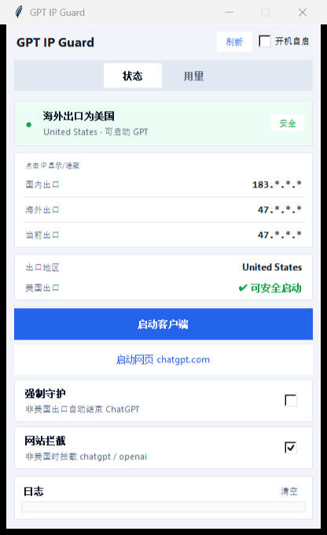

# GPT IP Guard

> 防止忘记开代理就启动 ChatGPT 导致封号的 Windows 小工具。

**英文**：A tiny Windows tray app that checks your overseas exit IP before you launch ChatGPT, blocks access when it's not US, and tracks real local token usage.

## 功能

| 功能 | 说明 |
|------|------|
| 出口 IP 面板 | 国内出口 / 海外出口 / 当前生效出口，点击 IP 可显示/隐藏后三段 |
| 美国出口检测 | 海外出口为美国时才允许启动 GPT；否则拦截网站 |
| 网站拦截 | 非美国出口时通过 hosts 拦截 `chatgpt.com` / `openai.com` |
| 强制守护 | 检测到 ChatGPT 客户端且非美国出口时，立即强制结束进程 |
| 启动入口 | 一键启动桌面客户端 / 网页（支持商店版与安装版） |
| 用量统计 | Token 输入 / 输出 / 缓存，曲线趋势，7 天 / 30 天 / 全部筛选 |
| 真实数据导入 | 从本机 Codex / ChatGPT 会话日志导入真实 token 用量 |
| 托盘 & 自启 | 关闭进托盘，托盘可退出；支持开机自启 |
| 单实例 | 重复打开会激活已有窗口，不会多开 |

## 界面预览

### 状态页 — 出口 IP 与安全启动



### 用量页 — Token 消耗趋势（真实本机数据）


## 快速开始

### 直接使用（推荐）

1. 下载 `dist/GPT-IP-Guard.exe`
2. 双击运行（建议右键「以管理员身份运行」以便修改 hosts）
3. 看到绿色「安全」后再点「启动客户端 / 启动网页」

> 只需要这一个 exe，不需要安装 Python。

### 从源码运行

```bash
pip install -r requirements.txt
python main.py
```

### 打包 EXE

```bash
python build_exe.py
```

产物：`dist/GPT-IP-Guard.exe`

## 使用说明

| 海外出口 | 网站 | 启动按钮 | 强制守护 |
|---------|------|---------|---------|
| 美国 | 放行 | 可用 | 不杀进程 |
| 非美国 | hosts 拦截 | 禁用 | 开启时强杀 ChatGPT |

- **IP 遮罩**：默认显示 `47.*.*.*`，点击 IP 切换完整地址
- **用量**：可手动记录，或点「导入本机数据」从 Codex 会话日志恢复真实 token 消耗
- **托盘**：点关闭最小化到托盘；托盘右键「退出」才真正退出
- **开机自启**：右上角勾选，或托盘菜单切换

## 项目结构

```
gpt-ip-guard/
├── main.py              # 主程序（tkinter UI + 托盘）
├── core/
│   ├── ip_checker.py    # 国内外出口 IP 检测
│   ├── blocker.py       # hosts 拦截
│   ├── process_guard.py # ChatGPT 进程守护 / 启动
│   ├── usage.py         # 本地 Token 用量 SQLite
│   └── importer.py      # 从本机 Codex 会话导入真实用量
├── build_exe.py         # PyInstaller 打包
├── assets_icon.ico      # 应用 / 托盘图标
└── screenshots/         # 真实软件截图
```

## 依赖

- Python 3.10+
- requests, psutil, pystray, Pillow
- PyInstaller（仅打包时）

## License

MIT
